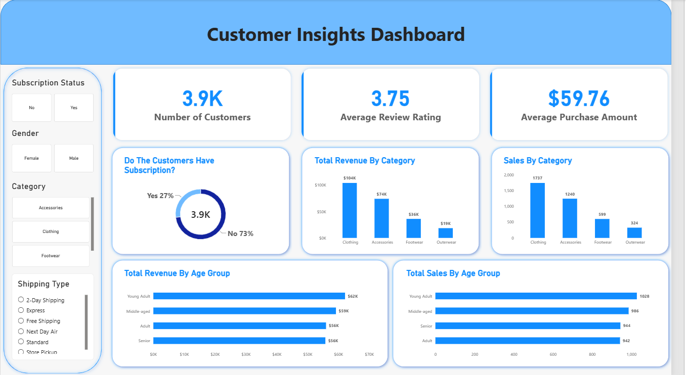
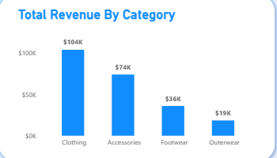
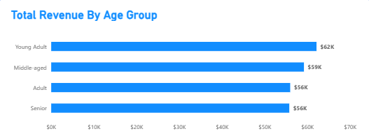

# Customer Shopping Behavior Analysis

This project analyzes the shopping behavior of retail customers to help a company identify trends, improve engagement, and optimize marketing and product strategies.

The full workflow includes data cleaning in Python, business analysis using PostgreSQL, and an interactive Power BI dashboard.

### Project Workflow
1. Data preparation and cleaning using **Python (Jupyter Notebook + Pandas)**
2. Business analysis with **10 SQL queries in PostgreSQL**
3. Interactive dashboard built in **Power BI**
4. Project report and presentation

### Dataset
- 3,900 customer purchases
- Demographics: age, gender, location, subscription status
- Purchase details: category, item, amount, season, review rating, shipping type, payment method, discounts, etc.

**Overall figures:**
- Total Revenue: $233,081
- Average Purchase: $59.76
- Average Review Rating: 3.75

### Key Insights
- Only **27%** of customers have a subscription
- **Clothing** is the highest revenue and sales category
- **Young Adults** generate the highest total revenue
- Discounts were applied on nearly half of purchases but did not increase average purchase value
- None of the female customers in the dataset have a subscription
- Top-rated / strong performing items include Gloves, Sandals, Boots, Jewelry, and Blouse

### Tools Used
- Python (Pandas, Jupyter Notebook)
- PostgreSQL
- Power BI
- Gamma (presentation)

### Dashboard Screenshots

**Main Dashboard**  

**Revenue by Category**  

**Revenue by Age Group**  

### How to View
1. Download the `.pbix` file
2. Open it in Power BI Desktop
3. Use the filters (Subscription, Gender, Category, Shipping Type) to explore the data

### Project Structure
- `/python` → Jupyter Notebook (cleaning + EDA)
- `/sql` → PostgreSQL queries
- `/powerbi` → Power BI dashboard
- `/report` → Full project report
